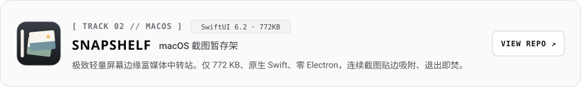
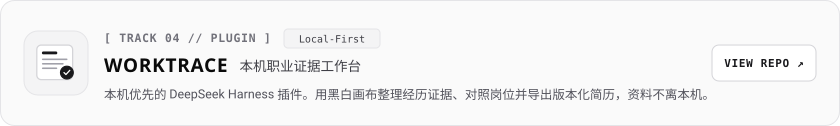
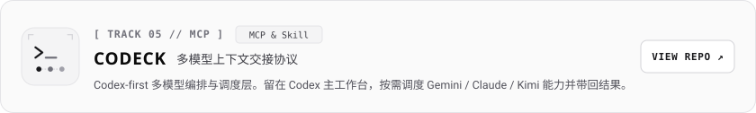

<picture>
  <source media="(prefers-color-scheme: dark)" srcset="assets/cards/header_dark.svg?v=5">
  <source media="(prefers-color-scheme: light)" srcset="assets/cards/header_light.svg?v=5">
  
</picture>

<a href="https://isdou.info"><picture><source media="(prefers-color-scheme: dark)" srcset="assets/cards/btn_blog_dark.svg?v=4"><source media="(prefers-color-scheme: light)" srcset="assets/cards/btn_blog_light.svg?v=4"></picture></a>&nbsp;<a href="https://x.com/dou_dev"><picture><source media="(prefers-color-scheme: dark)" srcset="assets/cards/btn_x_dark.svg?v=4"><source media="(prefers-color-scheme: light)" srcset="assets/cards/btn_x_light.svg?v=4"></picture></a>&nbsp;<a href="mailto:me@isdou.info"><picture><source media="(prefers-color-scheme: dark)" srcset="assets/cards/btn_mail_dark.svg?v=4"><source media="(prefers-color-scheme: light)" srcset="assets/cards/btn_mail_light.svg?v=4"></picture></a>

 

<picture>
  <source media="(prefers-color-scheme: dark)" srcset="assets/cards/section_tracks_dark.svg">
  <source media="(prefers-color-scheme: light)" srcset="assets/cards/section_tracks_light.svg">
  
</picture>

 

<a href="https://apps.apple.com/cn/app/lifelogs-%E5%90%8C%E4%B8%80%E5%A4%A9%E5%A4%9A%E5%B9%B4%E5%89%8D%E7%9A%84%E4%BD%A0/id6478393048">
  <picture>
    <source media="(prefers-color-scheme: dark)" srcset="assets/cards/track1_lifelogs_dark.svg">
    <source media="(prefers-color-scheme: light)" srcset="assets/cards/track1_lifelogs_light.svg">
    
  </picture>
</a>

<a href="https://github.com/isdou/SnapShelf">
  <picture>
    <source media="(prefers-color-scheme: dark)" srcset="assets/cards/track2_snapshelf_dark.svg">
    <source media="(prefers-color-scheme: light)" srcset="assets/cards/track2_snapshelf_light.svg">
    
  </picture>
</a>

<a href="https://github.com/isdou/DouOS-Releases">
  <picture>
    <source media="(prefers-color-scheme: dark)" srcset="assets/cards/track3_douos_dark.svg?v=2">
    <source media="(prefers-color-scheme: light)" srcset="assets/cards/track3_douos_light.svg?v=2">
    
  </picture>
</a>

<a href="https://github.com/isdou/dsh-worktrace">
  <picture>
    <source media="(prefers-color-scheme: dark)" srcset="assets/cards/track4_worktrace_dark.svg">
    <source media="(prefers-color-scheme: light)" srcset="assets/cards/track4_worktrace_light.svg">
    
  </picture>
</a>

<a href="https://github.com/isdou/codeck">
  <picture>
    <source media="(prefers-color-scheme: dark)" srcset="assets/cards/track5_codeck_dark.svg">
    <source media="(prefers-color-scheme: light)" srcset="assets/cards/track5_codeck_light.svg">
    
  </picture>
</a>

 

<picture>
  <source media="(prefers-color-scheme: dark)" srcset="assets/cards/section_telemetry_dark.svg">
  <source media="(prefers-color-scheme: light)" srcset="assets/cards/section_telemetry_light.svg">
  
</picture>

 

<a href="https://tokens.ci/u/isdou">
  <picture>
    <source media="(prefers-color-scheme: dark)" srcset="https://tokens.ci/api/embed/isdou/svg?theme=dark&template=graph&color=monochrome&today=1&tokens=compact&cost=compact">
    <source media="(prefers-color-scheme: light)" srcset="https://tokens.ci/api/embed/isdou/svg?theme=light&template=graph&color=monochrome&today=1&tokens=compact&cost=compact">
    
  </picture>
</a>

