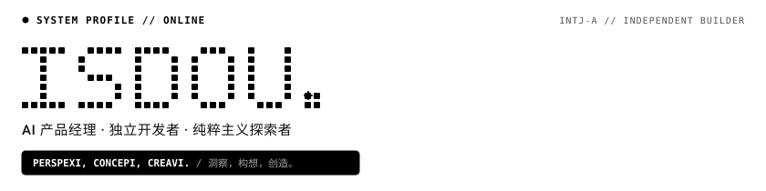
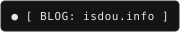
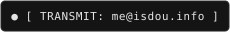
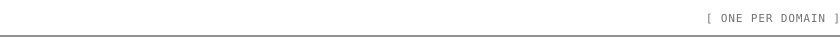

  
  
  

 

 

 

 

<a href="https://tokens.ci/u/isdou">
  <picture>
    <source media="(prefers-color-scheme: dark)" srcset="https://tokens.ci/api/embed/isdou/svg?theme=dark&template=graph&color=monochrome&today=1&tokens=compact&cost=compact">
    <source media="(prefers-color-scheme: light)" srcset="https://tokens.ci/api/embed/isdou/svg?theme=light&template=graph&color=monochrome&today=1&tokens=compact&cost=compact">
    
  </picture>
</a>

 

> **[ LOGIC_CORE // METHODOLOGY ]**  
> “大部分作品由 **AI Pair Programming** 完成 —— 想法是我的，架构由我把控，代码由我们一起编写。”  
> *PURE MONOCHROME. ZERO SUPERFLUOUS CODE. ONLY CLEAR SIGNALS.*
